# EXPERIMENT-01: BUILDING LOGICAL CIRCUITS

## DATE: 18.11.26
## NAME: SHAURYA KAKKAR
## REG NO.: RA2511030010334
## DEPARTMENT: Networking and Communications
## SECTION: Y1

---

## 1. Aim

To design, implement, simplify, and verify combinational logic circuits using Boolean algebra and digital logic gates.

## 2. Boolean Notation

Use the following notation throughout this experiment:

| Symbol | Meaning | Example |
|---|---|---|
| `!A` | NOT A | `!A` |
| `A & B` | AND | `A & B` |
| `A \| B` | OR | `A \| B` |
| `A ^ B` | XOR | `A ^ B` |
| `A XNOR B` | XNOR | `A XNOR B` |

**Important:** In these equations, `!` means NOT, `&` means AND, `|` means OR, and `^` means XOR. Parentheses determine the order of operations.

## 3. Advanced Boolean Equations

### Equation 1: Four-Input Sum-of-Products

```text
F1 = (!A & B & C)
   | (A & B & !D)
   | (!B & C & D)
   | (A & !C & D)
```

**Inputs:** A, B, C, D  
**Output:** F1  
**Challenge:** Simplify the expression and compare gate counts.

#### ✅ Answer – Equation 1

**Minterms:** F1 = Σm(3, 6, 7, 9, 11, 12, 13, 14)  **Maxterms (zeros):** ΠM(0, 1, 2, 4, 5, 8, 10, 15)

**Simplification (K-map):**

- Every product term in the given SOP is already a prime implicant and none can be merged, so the **minimal SOP is the original expression**:
  `F1 = !A&B&C | A&B&!D | !B&C&D | A&!C&D`
- Grouping the **zeros** instead gives a much smaller **minimal POS**:

```text
F1 = (A | C) & (B | D) & (!A | !B | !C | !D)
   = (A | C) & (B | D) & NAND(A, B, C, D)
```

(0 when A = C = 0, when B = D = 0, or when all four inputs are 1 – exactly the 8 maxterms.)

**Circuit – original SOP:**

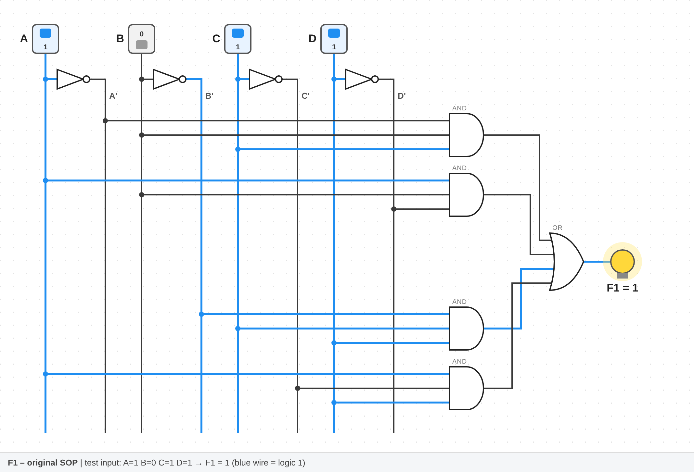

**Circuit – simplified:**

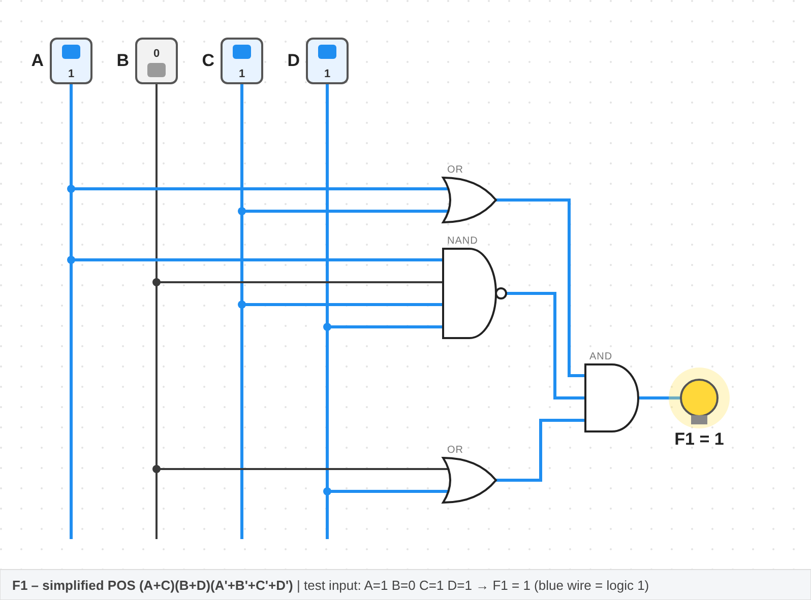

**Gate-count comparison:**

| Circuit | AND | OR | NOT | XOR/XNOR | NAND | NOR | Total gates | Logic depth |
|---|---:|---:|---:|---:|---:|---:|---:|---:|
| F1 – original SOP | 4 | 1 | 4 | – | – | – | **9** | **3** |
| F1 – simplified POS  (A+C)(B+D)(A'+B'+C'+D') | 1 | 2 | – | – | 1 | – | **4** | **2** |

The simplified circuit needs **5 fewer gates (9 → 4)**, no inverters, and one less logic level (3 → 2).

<details>
<summary><b>Truth table for F1 – all 16 input combinations (click to expand)</b></summary>

| ABCD | Expected F1 | Observed (original SOP) | Observed (simplified POS) | Status |
|---|---|---|---|---|
| 0000 | 0 | 0 | 0 | ✅ Pass |
| 0001 | 0 | 0 | 0 | ✅ Pass |
| 0010 | 0 | 0 | 0 | ✅ Pass |
| 0011 | 1 | 1 | 1 | ✅ Pass |
| 0100 | 0 | 0 | 0 | ✅ Pass |
| 0101 | 0 | 0 | 0 | ✅ Pass |
| 0110 | 1 | 1 | 1 | ✅ Pass |
| 0111 | 1 | 1 | 1 | ✅ Pass |
| 1000 | 0 | 0 | 0 | ✅ Pass |
| 1001 | 1 | 1 | 1 | ✅ Pass |
| 1010 | 0 | 0 | 0 | ✅ Pass |
| 1011 | 1 | 1 | 1 | ✅ Pass |
| 1100 | 1 | 1 | 1 | ✅ Pass |
| 1101 | 1 | 1 | 1 | ✅ Pass |
| 1110 | 1 | 1 | 1 | ✅ Pass |
| 1111 | 0 | 0 | 0 | ✅ Pass |

</details>

**Verification:** 16/16 combinations pass (8 combinations give F1 = 1, 8 give F1 = 0).

### Equation 2: Product-of-Sums Circuit

```text
F2 = (A | !B | C)
   & (!A | B | D)
   & (B | !C | !D)
```

**Inputs:** A, B, C, D  
**Output:** F2  
**Challenge:** Implement the circuit using NAND gates and verify functional equivalence.

#### ✅ Answer – Equation 2

**Minterms:** F2 = Σm(0, 1, 2, 6, 7, 9, 12, 13, 14, 15)  **Maxterms:** ΠM(3, 4, 5, 8, 10, 11)

The three sum terms are already prime implicates of the zeros, so the minimal POS is the given expression. (Minimal SOP: `A&B | B&C | !B&!C&D | !A&!B&!D`.)

**NAND conversion:** an OR term with inverted literals is a NAND of the complemented literals (De Morgan: `X | Y | Z = !( !X & !Y & !Z )`):

```text
(A | !B | C)  = NAND(!A,  B, !C)
(!A | B | D)  = NAND( A, !B, !D)
(B | !C | !D) = NAND(!B,  C,  D)
F2 = T1 & T2 & T3 = NAND( NAND(T1, T2, T3) )      // last NAND used as an inverter
!X = NAND(X, X)                                    // input inverters
```

**Circuit – original POS:**

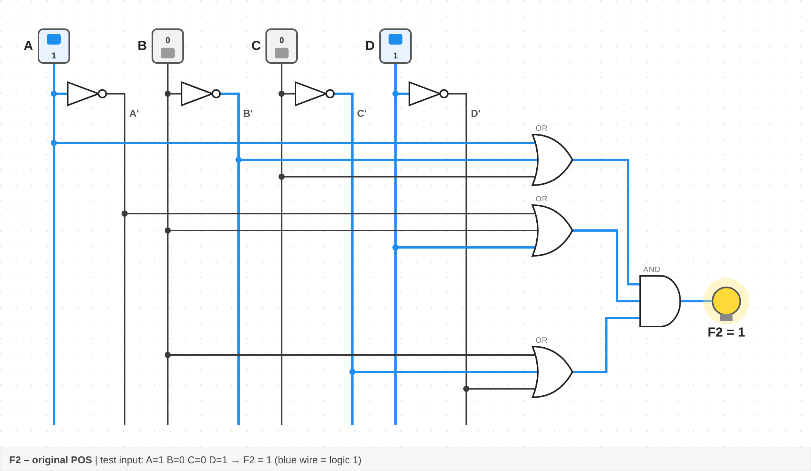

**Circuit – NAND-only implementation:**

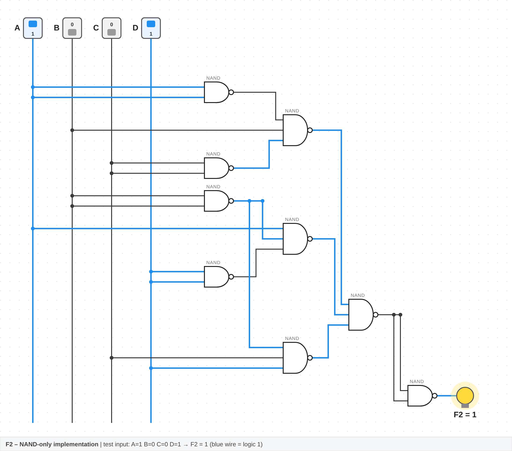

| Circuit | AND | OR | NOT | XOR/XNOR | NAND | NOR | Total gates | Logic depth |
|---|---:|---:|---:|---:|---:|---:|---:|---:|
| F2 – original POS | 1 | 3 | 4 | – | – | – | **8** | **3** |
| F2 – NAND-only implementation | – | – | – | – | 9 | – | **9** | **4** |

**Functional equivalence:** the NAND-only circuit gives the same output as the original equation for all 16 combinations (see table) ⇒ the two circuits are equivalent.

<details>
<summary><b>Truth table for F2 – all 16 input combinations (click to expand)</b></summary>

| ABCD | Expected F2 | Observed (original POS) | Observed (NAND-only implementation) | Status |
|---|---|---|---|---|
| 0000 | 1 | 1 | 1 | ✅ Pass |
| 0001 | 1 | 1 | 1 | ✅ Pass |
| 0010 | 1 | 1 | 1 | ✅ Pass |
| 0011 | 0 | 0 | 0 | ✅ Pass |
| 0100 | 0 | 0 | 0 | ✅ Pass |
| 0101 | 0 | 0 | 0 | ✅ Pass |
| 0110 | 1 | 1 | 1 | ✅ Pass |
| 0111 | 1 | 1 | 1 | ✅ Pass |
| 1000 | 0 | 0 | 0 | ✅ Pass |
| 1001 | 1 | 1 | 1 | ✅ Pass |
| 1010 | 0 | 0 | 0 | ✅ Pass |
| 1011 | 0 | 0 | 0 | ✅ Pass |
| 1100 | 1 | 1 | 1 | ✅ Pass |
| 1101 | 1 | 1 | 1 | ✅ Pass |
| 1110 | 1 | 1 | 1 | ✅ Pass |
| 1111 | 1 | 1 | 1 | ✅ Pass |

</details>

**Verification:** 16/16 combinations pass (10 combinations give F2 = 1, 6 give F2 = 0).

### Equation 3: Nested Complement Logic

```text
F3 = !(
       ((! (A | B)) | (C & D))
       &
       (A | (!(B | C)))
     )
```

**Inputs:** A, B, C, D  
**Output:** F3  
**Challenge:** Apply De Morgan's theorems and implement the circuit using NAND and NOR gates.

#### ✅ Answer – Equation 3

Let `X = !(A|B) | (C&D)` and `Y = A | !(B|C)`, so `F3 = !(X & Y)`.

**Applying De Morgan's theorems:**

```text
F3 = !(X & Y) = !X | !Y                                  (De Morgan 1)
!X = !( !(A|B) | C&D ) = (A|B) & !(C&D) = (A|B)&(!C|!D)  (De Morgan 2, then 1)
!Y = !( A | !(B|C) )   = !A & (B|C)                       (De Morgan 2)

F3 = (A|B)&(!C|!D) | !A&(B|C)
   = !A&B | !A&C | A&!C | C&!D                            (minimal SOP)
   = (A | B | C) & (!A | !C | !D)                         (minimal POS)
```

**Minterms:** F3 = Σm(2, 3, 4, 5, 6, 7, 8, 9, 10, 12, 13, 14)

**NAND / NOR implementation** (from the minimal POS):

```text
P  = NOR(A, B, C)        = !(A|B|C)
Q  = NAND(A, C, D)       = !A | !C | !D
R  = NOR(Q, Q)           = !Q                      // NOR used as inverter
F3 = NOR(P, R)           = !P & Q = (A|B|C) & (!A|!C|!D)
```

**Circuit – original expression:**

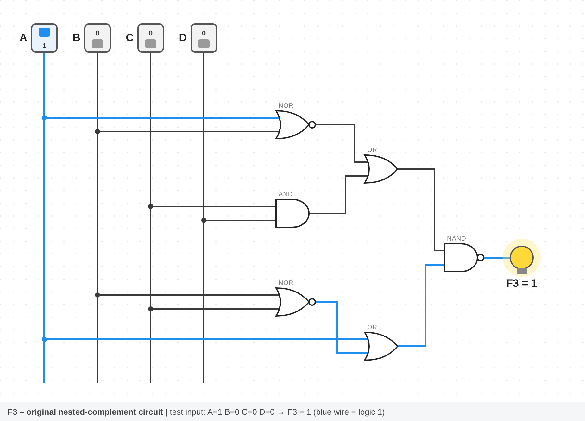

**Circuit – NAND/NOR implementation:**

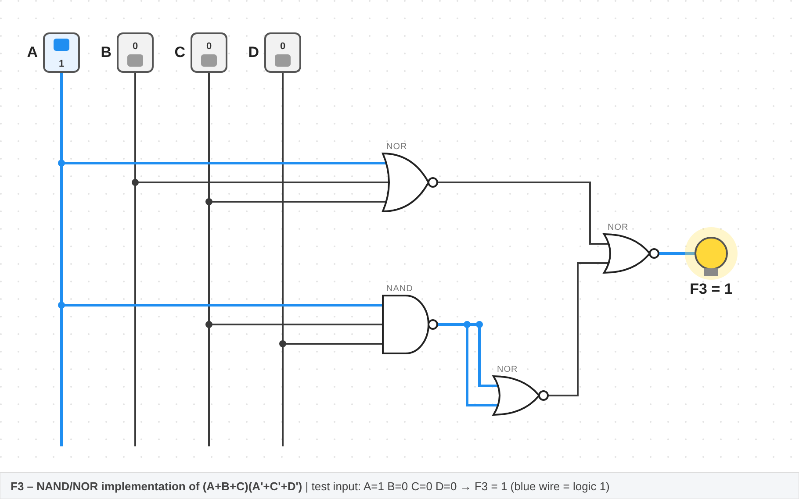

| Circuit | AND | OR | NOT | XOR/XNOR | NAND | NOR | Total gates | Logic depth |
|---|---:|---:|---:|---:|---:|---:|---:|---:|
| F3 – original nested-complement circuit | 1 | 2 | – | – | 1 | 2 | **6** | **3** |
| F3 – NAND/NOR implementation of (A+B+C)(A'+C'+D') | – | – | – | – | 1 | 3 | **4** | **3** |

<details>
<summary><b>Truth table for F3 – all 16 input combinations (click to expand)</b></summary>

| ABCD | Expected F3 | Observed (original nested-complement circuit) | Observed (NAND/NOR implementation of (A+B+C)(A'+C'+D')) | Status |
|---|---|---|---|---|
| 0000 | 0 | 0 | 0 | ✅ Pass |
| 0001 | 0 | 0 | 0 | ✅ Pass |
| 0010 | 1 | 1 | 1 | ✅ Pass |
| 0011 | 1 | 1 | 1 | ✅ Pass |
| 0100 | 1 | 1 | 1 | ✅ Pass |
| 0101 | 1 | 1 | 1 | ✅ Pass |
| 0110 | 1 | 1 | 1 | ✅ Pass |
| 0111 | 1 | 1 | 1 | ✅ Pass |
| 1000 | 1 | 1 | 1 | ✅ Pass |
| 1001 | 1 | 1 | 1 | ✅ Pass |
| 1010 | 1 | 1 | 1 | ✅ Pass |
| 1011 | 0 | 0 | 0 | ✅ Pass |
| 1100 | 1 | 1 | 1 | ✅ Pass |
| 1101 | 1 | 1 | 1 | ✅ Pass |
| 1110 | 1 | 1 | 1 | ✅ Pass |
| 1111 | 0 | 0 | 0 | ✅ Pass |

</details>

**Verification:** 16/16 combinations pass (12 combinations give F3 = 1, 4 give F3 = 0).

### Equation 4: XOR-XNOR Combinational Circuit

```text
F4 = ((A XOR B) & (C XNOR D))
   | (!A & B & (C XOR D))
```

**Inputs:** A, B, C, D  
**Output:** F4  
**Challenge:** Compare an XOR/XNOR implementation with a basic-gate implementation.

#### ✅ Answer – Equation 4

**Simplification:** expand `A XOR B = !A&B | A&!B` and note `(C XNOR D) | (C XOR D) = 1`:

```text
F4 = (!A&B | A&!B)&(C XNOR D) | !A&B&(C XOR D)
   = !A&B&[(C XNOR D) | (C XOR D)] | A&!B&(C XNOR D)
   = !A&B | A&!B&(C XNOR D)
   = !A&B | A&!B&C&D | A&!B&!C&!D                (basic-gate SOP)
```

**Minterms:** F4 = Σm(4, 5, 6, 7, 8, 11)

**Circuit – XOR / XNOR implementation:**

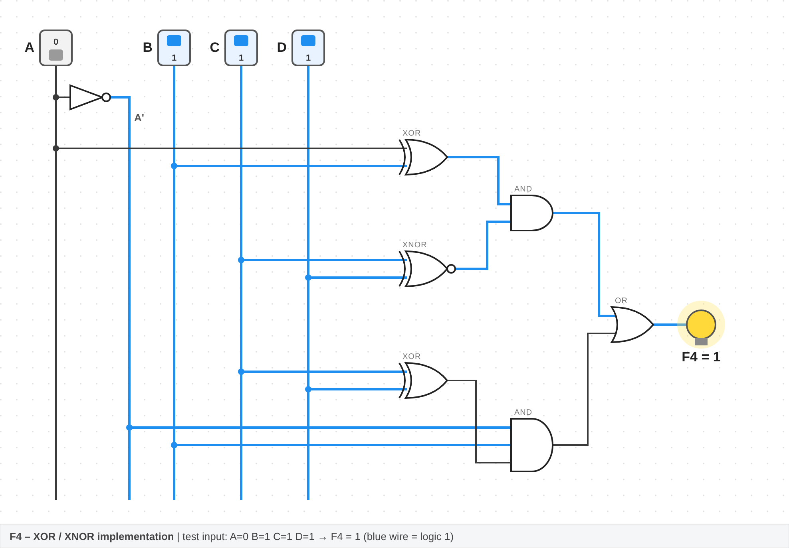

**Circuit – basic-gate implementation:**

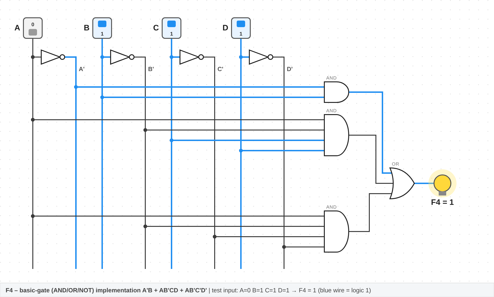

**Comparison:**

| Circuit | AND | OR | NOT | XOR/XNOR | NAND | NOR | Total gates | Logic depth |
|---|---:|---:|---:|---:|---:|---:|---:|---:|
| F4 – XOR / XNOR implementation | 2 | 1 | 1 | 3 | – | – | **7** | **3** |
| F4 – basic-gate (AND/OR/NOT) implementation  A'B + AB'CD + AB'C'D' | 3 | 1 | 4 | – | – | – | **8** | **3** |

- The XOR/XNOR version uses fewer gates (7 vs 8) and fewer inverters, but XOR/XNOR gates are internally larger (each ≈ 2 AND + 1 OR + 2 NOT, or 4 NANDs). Built purely from basic gates, the XOR form would need about 19 gates, so the **SOP basic-gate circuit is cheaper in real hardware**.
- The best mixed form is `!A&B | A&!B&(C XNOR D)` = 2 NOT + 2 AND + 1 XNOR + 1 OR = **6 gates**, depth 3.

<details>
<summary><b>Truth table for F4 – all 16 input combinations (click to expand)</b></summary>

| ABCD | Expected F4 | Observed (XOR / XNOR implementation) | Observed (basic-gate (AND/OR/NOT) implementation) | Status |
|---|---|---|---|---|
| 0000 | 0 | 0 | 0 | ✅ Pass |
| 0001 | 0 | 0 | 0 | ✅ Pass |
| 0010 | 0 | 0 | 0 | ✅ Pass |
| 0011 | 0 | 0 | 0 | ✅ Pass |
| 0100 | 1 | 1 | 1 | ✅ Pass |
| 0101 | 1 | 1 | 1 | ✅ Pass |
| 0110 | 1 | 1 | 1 | ✅ Pass |
| 0111 | 1 | 1 | 1 | ✅ Pass |
| 1000 | 1 | 1 | 1 | ✅ Pass |
| 1001 | 0 | 0 | 0 | ✅ Pass |
| 1010 | 0 | 0 | 0 | ✅ Pass |
| 1011 | 1 | 1 | 1 | ✅ Pass |
| 1100 | 0 | 0 | 0 | ✅ Pass |
| 1101 | 0 | 0 | 0 | ✅ Pass |
| 1110 | 0 | 0 | 0 | ✅ Pass |
| 1111 | 0 | 0 | 0 | ✅ Pass |

</details>

**Verification:** 16/16 combinations pass (6 combinations give F4 = 1, 10 give F4 = 0).

### Equation 5: Five-Input Logic Function

```text
F5 = (A & B & !C)
   | (!A & D & E)
   | (B & C & !E)
   | (!B & C & D)
```

**Inputs:** A, B, C, D, E  
**Output:** F5  
**Challenge:** Generate and verify all 32 input combinations.

#### ✅ Answer – Equation 5

**Minterms:** F5 = Σm(3, 6, 7, 11, 12, 14, 15, 22, 23, 24, 25, 26, 27, 28, 30) – 15 ones out of 32.

**Simplification:** on the 5-variable K-map all four product terms are **essential prime implicants**, and no two terms can be combined, so the given expression is already the minimal SOP:

```text
F5 = A&B&!C | !A&D&E | B&C&!E | !B&C&D
```

**Circuit:**

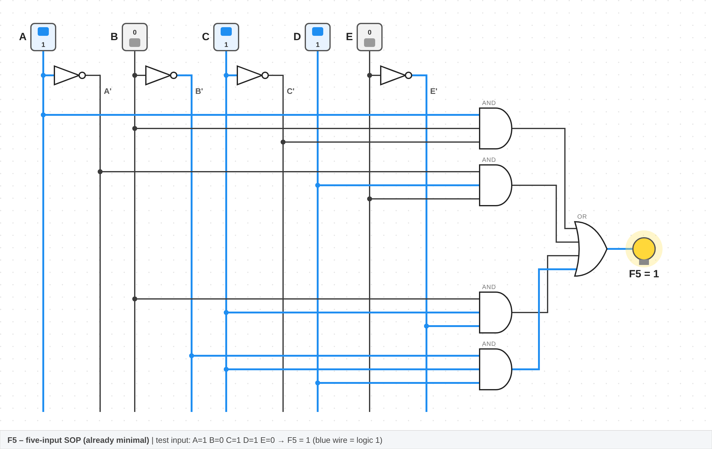

| Circuit | AND | OR | NOT | XOR/XNOR | NAND | NOR | Total gates | Logic depth |
|---|---:|---:|---:|---:|---:|---:|---:|---:|
| F5 – five-input SOP (already minimal) | 4 | 1 | 4 | – | – | – | **9** | **3** |

<details>
<summary><b>Truth table for F5 – all 32 input combinations (click to expand)</b></summary>

| ABCDE | Expected F5 | Observed (five-input SOP (already minimal)) | Status |
|---|---|---|---|
| 00000 | 0 | 0 | ✅ Pass |
| 00001 | 0 | 0 | ✅ Pass |
| 00010 | 0 | 0 | ✅ Pass |
| 00011 | 1 | 1 | ✅ Pass |
| 00100 | 0 | 0 | ✅ Pass |
| 00101 | 0 | 0 | ✅ Pass |
| 00110 | 1 | 1 | ✅ Pass |
| 00111 | 1 | 1 | ✅ Pass |
| 01000 | 0 | 0 | ✅ Pass |
| 01001 | 0 | 0 | ✅ Pass |
| 01010 | 0 | 0 | ✅ Pass |
| 01011 | 1 | 1 | ✅ Pass |
| 01100 | 1 | 1 | ✅ Pass |
| 01101 | 0 | 0 | ✅ Pass |
| 01110 | 1 | 1 | ✅ Pass |
| 01111 | 1 | 1 | ✅ Pass |
| 10000 | 0 | 0 | ✅ Pass |
| 10001 | 0 | 0 | ✅ Pass |
| 10010 | 0 | 0 | ✅ Pass |
| 10011 | 0 | 0 | ✅ Pass |
| 10100 | 0 | 0 | ✅ Pass |
| 10101 | 0 | 0 | ✅ Pass |
| 10110 | 1 | 1 | ✅ Pass |
| 10111 | 1 | 1 | ✅ Pass |
| 11000 | 1 | 1 | ✅ Pass |
| 11001 | 1 | 1 | ✅ Pass |
| 11010 | 1 | 1 | ✅ Pass |
| 11011 | 1 | 1 | ✅ Pass |
| 11100 | 1 | 1 | ✅ Pass |
| 11101 | 0 | 0 | ✅ Pass |
| 11110 | 1 | 1 | ✅ Pass |
| 11111 | 0 | 0 | ✅ Pass |

</details>

**Verification:** 32/32 combinations pass (15 combinations give F5 = 1, 17 give F5 = 0).

### Equation 6: Six-Input Mixed Logic

```text
F6 = ((A | B) & !(C | D))
   | ((C XOR E) & (D | G))
   | (!A & B & E)
```

**Inputs:** A, B, C, D, E, G  
**Output:** F6  
**Challenge:** Calculate gate count and logic depth. Verify all 64 input combinations.

#### ✅ Answer – Equation 6

**Minterms:** F6 = 37 ones out of 64 combinations.

**Gate count and logic depth** (circuit implemented exactly as written; `!(C|D)` uses one NOR gate):

| Circuit | AND | OR | NOT | XOR/XNOR | NAND | NOR | Total gates | Logic depth |
|---|---:|---:|---:|---:|---:|---:|---:|---:|
| F6 – six-input mixed logic | 3 | 3 | 1 | 1 | – | 1 | **9** | **3** |

- Level 1: OR(A,B), NOR(C,D), XOR(C,E), OR(D,G), NOT A  Level 2: three AND gates  Level 3: OR3 ⇒ **logic depth = 3**.
- If the NOR must be built from basic gates it becomes OR + NOT → **10 gates**, and the path OR → NOT → AND → OR gives a depth of **4**.
- The minimal SOP of F6 has **7 product terms** (`!A&B&E | C&D&!E | C&G&!E | D&E&!C | E&G&!C | A&!C&!D | B&!C&!D`), which would need 7 AND + 1 OR + 4 NOT = 12 gates, so the **given factored form is the more economical circuit**.

**Circuit:**

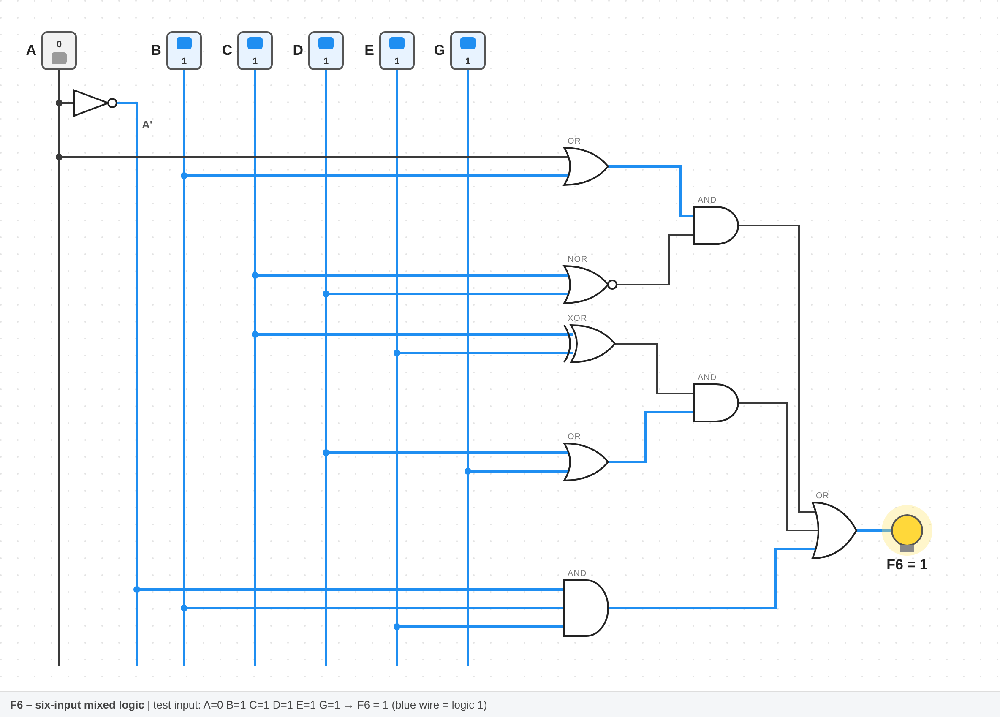

<details>
<summary><b>Truth table for F6 – all 64 input combinations (click to expand)</b></summary>

| ABCDEG | Expected F6 | Observed (six-input mixed logic) | Status |
|---|---|---|---|
| 000000 | 0 | 0 | ✅ Pass |
| 000001 | 0 | 0 | ✅ Pass |
| 000010 | 0 | 0 | ✅ Pass |
| 000011 | 1 | 1 | ✅ Pass |
| 000100 | 0 | 0 | ✅ Pass |
| 000101 | 0 | 0 | ✅ Pass |
| 000110 | 1 | 1 | ✅ Pass |
| 000111 | 1 | 1 | ✅ Pass |
| 001000 | 0 | 0 | ✅ Pass |
| 001001 | 1 | 1 | ✅ Pass |
| 001010 | 0 | 0 | ✅ Pass |
| 001011 | 0 | 0 | ✅ Pass |
| 001100 | 1 | 1 | ✅ Pass |
| 001101 | 1 | 1 | ✅ Pass |
| 001110 | 0 | 0 | ✅ Pass |
| 001111 | 0 | 0 | ✅ Pass |
| 010000 | 1 | 1 | ✅ Pass |
| 010001 | 1 | 1 | ✅ Pass |
| 010010 | 1 | 1 | ✅ Pass |
| 010011 | 1 | 1 | ✅ Pass |
| 010100 | 0 | 0 | ✅ Pass |
| 010101 | 0 | 0 | ✅ Pass |
| 010110 | 1 | 1 | ✅ Pass |
| 010111 | 1 | 1 | ✅ Pass |
| 011000 | 0 | 0 | ✅ Pass |
| 011001 | 1 | 1 | ✅ Pass |
| 011010 | 1 | 1 | ✅ Pass |
| 011011 | 1 | 1 | ✅ Pass |
| 011100 | 1 | 1 | ✅ Pass |
| 011101 | 1 | 1 | ✅ Pass |
| 011110 | 1 | 1 | ✅ Pass |
| 011111 | 1 | 1 | ✅ Pass |
| 100000 | 1 | 1 | ✅ Pass |
| 100001 | 1 | 1 | ✅ Pass |
| 100010 | 1 | 1 | ✅ Pass |
| 100011 | 1 | 1 | ✅ Pass |
| 100100 | 0 | 0 | ✅ Pass |
| 100101 | 0 | 0 | ✅ Pass |
| 100110 | 1 | 1 | ✅ Pass |
| 100111 | 1 | 1 | ✅ Pass |
| 101000 | 0 | 0 | ✅ Pass |
| 101001 | 1 | 1 | ✅ Pass |
| 101010 | 0 | 0 | ✅ Pass |
| 101011 | 0 | 0 | ✅ Pass |
| 101100 | 1 | 1 | ✅ Pass |
| 101101 | 1 | 1 | ✅ Pass |
| 101110 | 0 | 0 | ✅ Pass |
| 101111 | 0 | 0 | ✅ Pass |
| 110000 | 1 | 1 | ✅ Pass |
| 110001 | 1 | 1 | ✅ Pass |
| 110010 | 1 | 1 | ✅ Pass |
| 110011 | 1 | 1 | ✅ Pass |
| 110100 | 0 | 0 | ✅ Pass |
| 110101 | 0 | 0 | ✅ Pass |
| 110110 | 1 | 1 | ✅ Pass |
| 110111 | 1 | 1 | ✅ Pass |
| 111000 | 0 | 0 | ✅ Pass |
| 111001 | 1 | 1 | ✅ Pass |
| 111010 | 0 | 0 | ✅ Pass |
| 111011 | 0 | 0 | ✅ Pass |
| 111100 | 1 | 1 | ✅ Pass |
| 111101 | 1 | 1 | ✅ Pass |
| 111110 | 0 | 0 | ✅ Pass |
| 111111 | 0 | 0 | ✅ Pass |

</details>

**Verification:** 64/64 combinations pass (37 combinations give F6 = 1, 27 give F6 = 0).

### Equation 7: NAND-NOR Hybrid Logic

```text
F7 = (! (A & B) & !(C | D))
   | (!(A | C) & B & D)
```

**Inputs:** A, B, C, D  
**Output:** F7  
**Challenge:** Implement the function using NAND and NOR gates with any required input inversions.

#### ✅ Answer – Equation 7

**Minterms:** F7 = Σm(0, 4, 5, 8)

**NAND–NOR hybrid implementation** (sum of two products → NAND-NAND, products taken directly from NAND/NOR outputs, so **no input inverters are needed**):

```text
G1 = NAND(A, B)        G2 = NOR(C, D)
G3 = NAND(G1, G2)      = !( !(A&B) & !(C|D) )
G4 = NOR(A, C)
G5 = NAND(G4, B, D)    = !( !(A|C) & B & D )
F7 = NAND(G3, G5)      = !(A&B)&!(C|D) | !(A|C)&B&D
```

**Simplification:**

```text
F7 = (!A|!B)&!C&!D | !A&B&!C&D
   = !A&!C&!D | !B&!C&!D | !A&B&!C&D
   = !A&B&!C | !B&!C&!D               (consensus term !A&!C&!D removed)
   = !C & (!A&B | !B&!D)
```

**Circuit – NAND-NOR hybrid:**

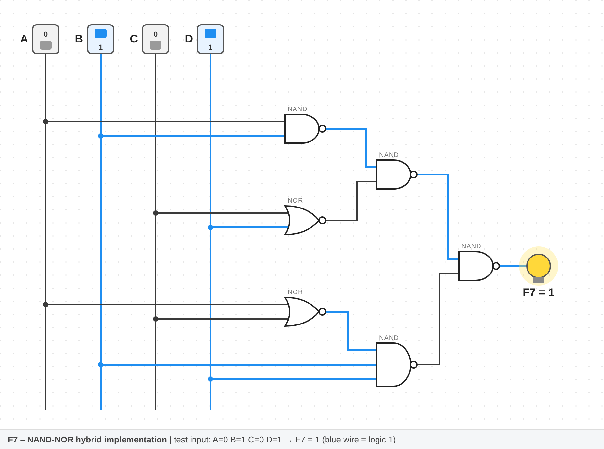

**Circuit – simplified, NOR-only:**  `T1 = NOR(A, !B, C)`, `T2 = NOR(B, C, D)`, `F7 = !NOR(T1, T2)`

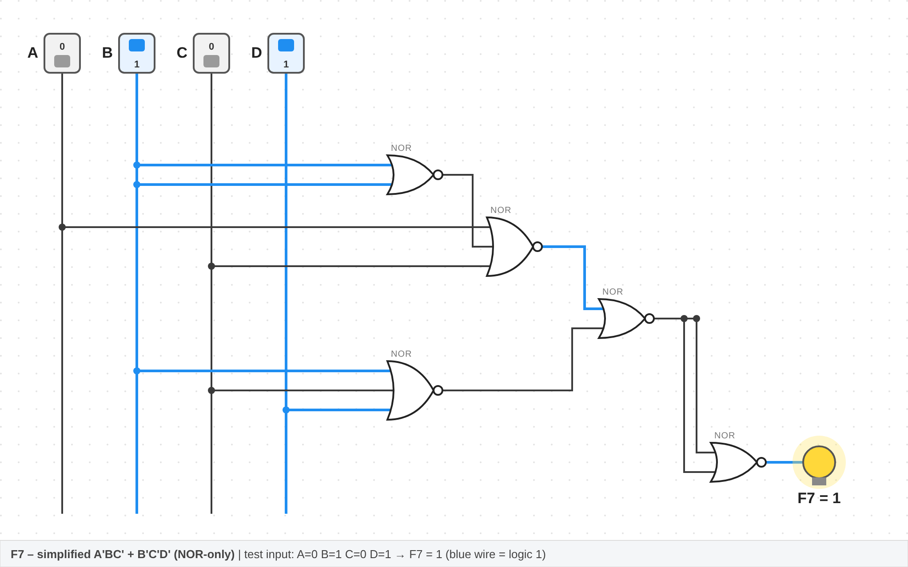

| Circuit | AND | OR | NOT | XOR/XNOR | NAND | NOR | Total gates | Logic depth |
|---|---:|---:|---:|---:|---:|---:|---:|---:|
| F7 – NAND-NOR hybrid implementation | – | – | – | – | 4 | 2 | **6** | **3** |
| F7 – simplified  A'BC' + B'C'D'  (NOR-only) | – | – | – | – | – | 5 | **5** | **4** |

<details>
<summary><b>Truth table for F7 – all 16 input combinations (click to expand)</b></summary>

| ABCD | Expected F7 | Observed (NAND-NOR hybrid implementation) | Observed (simplified) | Status |
|---|---|---|---|---|
| 0000 | 1 | 1 | 1 | ✅ Pass |
| 0001 | 0 | 0 | 0 | ✅ Pass |
| 0010 | 0 | 0 | 0 | ✅ Pass |
| 0011 | 0 | 0 | 0 | ✅ Pass |
| 0100 | 1 | 1 | 1 | ✅ Pass |
| 0101 | 1 | 1 | 1 | ✅ Pass |
| 0110 | 0 | 0 | 0 | ✅ Pass |
| 0111 | 0 | 0 | 0 | ✅ Pass |
| 1000 | 1 | 1 | 1 | ✅ Pass |
| 1001 | 0 | 0 | 0 | ✅ Pass |
| 1010 | 0 | 0 | 0 | ✅ Pass |
| 1011 | 0 | 0 | 0 | ✅ Pass |
| 1100 | 0 | 0 | 0 | ✅ Pass |
| 1101 | 0 | 0 | 0 | ✅ Pass |
| 1110 | 0 | 0 | 0 | ✅ Pass |
| 1111 | 0 | 0 | 0 | ✅ Pass |

</details>

**Verification:** 16/16 combinations pass (4 combinations give F7 = 1, 12 give F7 = 0).

### Equation 8: Six-Input Advanced Combinational Logic

```text
F8 = ((A XOR B) & (C XNOR D))
   | (!(A | B) & C & E)
   | (A & B & !(D | F))
```

**Inputs:** A, B, C, D, E, F  
**Output:** F8  
**Challenge:** Simplify the expression, design the circuit, and verify all 64 input combinations.

#### ✅ Answer – Equation 8

**Minterms:** F8 = Σm(10, 11, 14, 15, 16, 17, 18, 19, 28, 29, 30, 31, 32, 33, 34, 35, 44, 45, 46, 47, 48, 50, 56, 58) – 24 ones out of 64.

**Simplification:**

```text
F8 = (A XOR B)&(C XNOR D) | !(A|B)&C&E | A&B&!(D|F)
   = (A XOR B)&(C XNOR D) | !A&!B&C&E | A&B&!D&!F
```

The three terms are disjoint in A, B (`A XOR B`, `!A&!B`, `A&B`), so nothing can be merged. Expanding to a pure SOP gives a minimum of **6 product terms**:

```text
F8 = A&!B&C&D | !A&B&C&D | A&!B&!C&!D | !A&B&!C&!D | !A&!B&C&E | A&B&!D&!F
```

which needs 6 AND + 1 OR + 5 NOT = 12 gates. The XOR/XNOR-factored form below needs only **9 gates with depth 3**, so it is used as the simplified circuit.

**Circuit:**

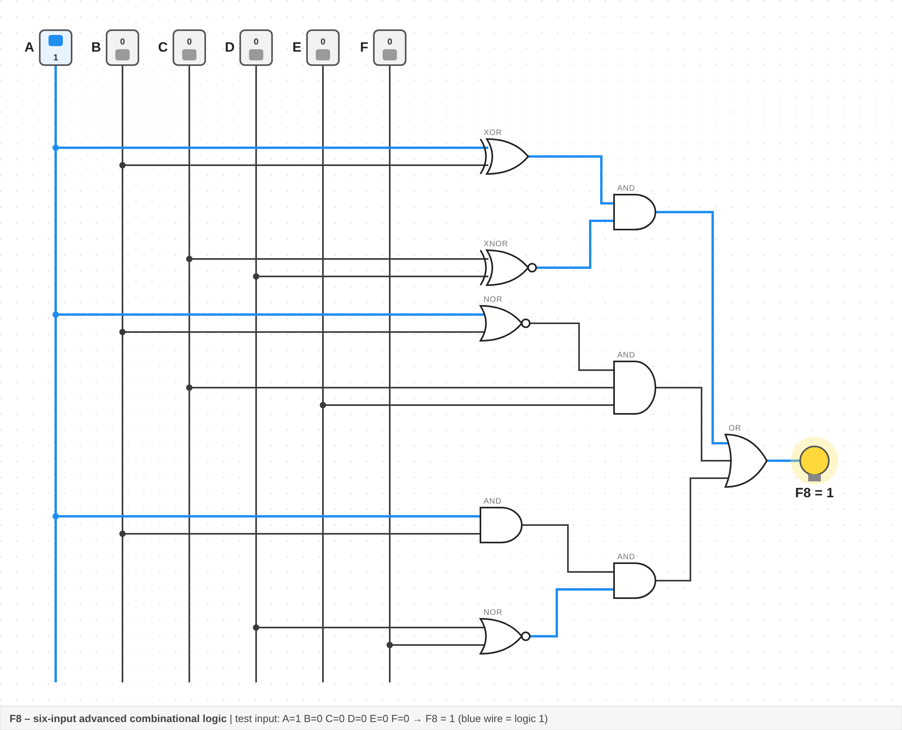

| Circuit | AND | OR | NOT | XOR/XNOR | NAND | NOR | Total gates | Logic depth |
|---|---:|---:|---:|---:|---:|---:|---:|---:|
| F8 – six-input advanced combinational logic | 4 | 1 | – | 2 | – | 2 | **9** | **3** |

<details>
<summary><b>Truth table for F8 – all 64 input combinations (click to expand)</b></summary>

| ABCDEF | Expected F8 | Observed (six-input advanced combinational logic) | Status |
|---|---|---|---|
| 000000 | 0 | 0 | ✅ Pass |
| 000001 | 0 | 0 | ✅ Pass |
| 000010 | 0 | 0 | ✅ Pass |
| 000011 | 0 | 0 | ✅ Pass |
| 000100 | 0 | 0 | ✅ Pass |
| 000101 | 0 | 0 | ✅ Pass |
| 000110 | 0 | 0 | ✅ Pass |
| 000111 | 0 | 0 | ✅ Pass |
| 001000 | 0 | 0 | ✅ Pass |
| 001001 | 0 | 0 | ✅ Pass |
| 001010 | 1 | 1 | ✅ Pass |
| 001011 | 1 | 1 | ✅ Pass |
| 001100 | 0 | 0 | ✅ Pass |
| 001101 | 0 | 0 | ✅ Pass |
| 001110 | 1 | 1 | ✅ Pass |
| 001111 | 1 | 1 | ✅ Pass |
| 010000 | 1 | 1 | ✅ Pass |
| 010001 | 1 | 1 | ✅ Pass |
| 010010 | 1 | 1 | ✅ Pass |
| 010011 | 1 | 1 | ✅ Pass |
| 010100 | 0 | 0 | ✅ Pass |
| 010101 | 0 | 0 | ✅ Pass |
| 010110 | 0 | 0 | ✅ Pass |
| 010111 | 0 | 0 | ✅ Pass |
| 011000 | 0 | 0 | ✅ Pass |
| 011001 | 0 | 0 | ✅ Pass |
| 011010 | 0 | 0 | ✅ Pass |
| 011011 | 0 | 0 | ✅ Pass |
| 011100 | 1 | 1 | ✅ Pass |
| 011101 | 1 | 1 | ✅ Pass |
| 011110 | 1 | 1 | ✅ Pass |
| 011111 | 1 | 1 | ✅ Pass |
| 100000 | 1 | 1 | ✅ Pass |
| 100001 | 1 | 1 | ✅ Pass |
| 100010 | 1 | 1 | ✅ Pass |
| 100011 | 1 | 1 | ✅ Pass |
| 100100 | 0 | 0 | ✅ Pass |
| 100101 | 0 | 0 | ✅ Pass |
| 100110 | 0 | 0 | ✅ Pass |
| 100111 | 0 | 0 | ✅ Pass |
| 101000 | 0 | 0 | ✅ Pass |
| 101001 | 0 | 0 | ✅ Pass |
| 101010 | 0 | 0 | ✅ Pass |
| 101011 | 0 | 0 | ✅ Pass |
| 101100 | 1 | 1 | ✅ Pass |
| 101101 | 1 | 1 | ✅ Pass |
| 101110 | 1 | 1 | ✅ Pass |
| 101111 | 1 | 1 | ✅ Pass |
| 110000 | 1 | 1 | ✅ Pass |
| 110001 | 0 | 0 | ✅ Pass |
| 110010 | 1 | 1 | ✅ Pass |
| 110011 | 0 | 0 | ✅ Pass |
| 110100 | 0 | 0 | ✅ Pass |
| 110101 | 0 | 0 | ✅ Pass |
| 110110 | 0 | 0 | ✅ Pass |
| 110111 | 0 | 0 | ✅ Pass |
| 111000 | 1 | 1 | ✅ Pass |
| 111001 | 0 | 0 | ✅ Pass |
| 111010 | 1 | 1 | ✅ Pass |
| 111011 | 0 | 0 | ✅ Pass |
| 111100 | 0 | 0 | ✅ Pass |
| 111101 | 0 | 0 | ✅ Pass |
| 111110 | 0 | 0 | ✅ Pass |
| 111111 | 0 | 0 | ✅ Pass |

</details>

**Verification:** 64/64 combinations pass (24 combinations give F8 = 1, 40 give F8 = 0).

## 4. Experimental Procedure

1. Identify all input variables and the output.
2. Draw the logic circuit for each equation.
3. Implement the circuit in Logisim Evolution, Proteus, or a digital logic trainer kit.
4. Apply all possible input combinations.
5. Record the expected and observed outputs.
6. Simplify the Boolean expression using Boolean algebra.
7. Build the simplified circuit and compare gate counts.
8. Save the circuit diagrams, truth tables, and verification screenshots.

## 5. Truth Table Requirements

| Number of inputs | Required combinations |
|---:|---:|
| 4 | 16 |
| 5 | 32 |
| 6 | 64 |

Use this format to record the results:

| Inputs | Expected output | Observed output | Status |
|---|---|---|---|
| 0000 |  |  |  |
| 0001 |  |  |  |
| 0010 |  |  |  |
| ... |  |  |  |

Extend the table to include every input combination required by each equation.

#### ✅ Answer – Truth Tables

The complete truth tables (16 / 32 / 64 rows) are given under each equation above and are also saved as CSV files in [`truth_tables/`](truth_tables/). "Expected" is computed from the original Boolean equation, and "Observed" is the output of the implemented gate circuit, simulated for every switch combination.

| Function | Inputs | Rows checked | Passed | Status |
|---|---:|---:|---:|---|
| F1 | 4 | 16 | 16 | ✅ All match |
| F2 | 4 | 16 | 16 | ✅ All match |
| F3 | 4 | 16 | 16 | ✅ All match |
| F4 | 4 | 16 | 16 | ✅ All match |
| F5 | 5 | 32 | 32 | ✅ All match |
| F6 | 6 | 64 | 64 | ✅ All match |
| F7 | 4 | 16 | 16 | ✅ All match |
| F8 | 6 | 64 | 64 | ✅ All match |

## 6. Performance Analysis

For each circuit, record:

- Number of AND gates
- Number of OR gates
- Number of NOT gates
- Number of XOR/XNOR gates
- Total gate count
- Logic depth
- Functional equivalence before and after simplification

#### ✅ Answer – Performance Analysis

| Circuit | AND | OR | NOT | XOR/XNOR | NAND | NOR | Total gates | Logic depth |
|---|---:|---:|---:|---:|---:|---:|---:|---:|
| F1 – original SOP | 4 | 1 | 4 | – | – | – | **9** | **3** |
| F1 – simplified POS  (A+C)(B+D)(A'+B'+C'+D') | 1 | 2 | – | – | 1 | – | **4** | **2** |
| F2 – original POS | 1 | 3 | 4 | – | – | – | **8** | **3** |
| F2 – NAND-only implementation | – | – | – | – | 9 | – | **9** | **4** |
| F3 – original nested-complement circuit | 1 | 2 | – | – | 1 | 2 | **6** | **3** |
| F3 – NAND/NOR implementation of (A+B+C)(A'+C'+D') | – | – | – | – | 1 | 3 | **4** | **3** |
| F4 – XOR / XNOR implementation | 2 | 1 | 1 | 3 | – | – | **7** | **3** |
| F4 – basic-gate (AND/OR/NOT) implementation  A'B + AB'CD + AB'C'D' | 3 | 1 | 4 | – | – | – | **8** | **3** |
| F5 – five-input SOP (already minimal) | 4 | 1 | 4 | – | – | – | **9** | **3** |
| F6 – six-input mixed logic | 3 | 3 | 1 | 1 | – | 1 | **9** | **3** |
| F7 – NAND-NOR hybrid implementation | – | – | – | – | 4 | 2 | **6** | **3** |
| F7 – simplified  A'BC' + B'C'D'  (NOR-only) | – | – | – | – | – | 5 | **5** | **4** |
| F8 – six-input advanced combinational logic | 4 | 1 | – | 2 | – | 2 | **9** | **3** |

*Logic depth counts the input inverters (NOT gates under the switches) as one level. NAND/NOR gates with tied inputs are used as inverters.*

**Functional equivalence before and after simplification:** every original circuit and its simplified / NAND / NOR / XOR version produced identical outputs for all input combinations (F1, F2, F3, F4, F7 compared pairwise – 0 mismatches).

## 7. Expected Results

The eight Boolean functions should be implemented successfully. Their outputs should match the theoretical truth tables for all input combinations.

## 8. Result

The logic circuits are designed, implemented, and verified using Boolean algebra and digital logic gates. The original and simplified circuits are compared based on gate count and logic depth.

## 9. Repository Structure

```text
EXPERIMENT-01-BUILDING-LOGICAL-CIRCUITS/
├── README.md
├── circuit_diagrams/
├── truth_tables/
├── simulation_files/
└── results/
```

## 10. Viva Questions

**1. What are universal logic gates?**

> **Universal gates** are gates from which *any* Boolean function can be built using only that one gate type. **NAND** and **NOR** are universal: e.g. NOT A = NAND(A, A), A AND B = NOT(NAND(A, B)), A OR B = NAND(!A, !B). (Used in Equations 2, 3 and 7.)

**2. State De Morgan's theorems.**

> **De Morgan's theorems:**<br>1. `!(A & B) = !A | !B` – the complement of a product is the sum of the complements.<br>2. `!(A | B) = !A & !B` – the complement of a sum is the product of the complements.

**3. What is the difference between SOP and POS?**

> **SOP (Sum of Products)** is an OR of AND terms, e.g. `A&B | !A&C`; it is built from the 1s (minterms) of the truth table and maps naturally to AND-OR or NAND-NAND logic. **POS (Product of Sums)** is an AND of OR terms, e.g. `(A|B) & (!A|C)`; it is built from the 0s (maxterms) and maps to OR-AND or NOR-NOR logic.

**4. How does XOR differ from XNOR?**

> **XOR** outputs 1 when the inputs are *different* (`A^B = !A&B | A&!B`, odd-parity detector). **XNOR** outputs 1 when the inputs are *equal* (`A XNOR B = A&B | !A&!B`, equality detector). XNOR is the complement of XOR.

**5. How can Boolean expressions be simplified?**

> Using **Boolean algebra laws** (identity, complement, absorption `A + AB = A`, consensus, distributive, De Morgan), **Karnaugh maps** (grouping adjacent 1s/0s in powers of two, practical up to 5–6 variables), or the **Quine–McCluskey tabulation method** (systematic, suitable for computer use).

**6. How many truth-table rows are required for six inputs?**

> For *n* inputs a truth table has 2ⁿ rows, so six inputs need **2⁶ = 64 rows**.

**7. What is logic depth?**

> **Logic depth** is the maximum number of gates a signal passes through on any path from an input to the output. It determines the worst-case propagation delay of the circuit – smaller depth means a faster circuit (e.g. F1 was reduced from depth 3 to depth 2).

**8. Why is functional verification necessary?**

> Functional verification checks that the built circuit produces the expected output for **every** input combination. It catches wiring mistakes, wrong gate types and algebra errors made during simplification, and proves that the simplified / NAND / NOR circuit is truly equivalent to the original expression before it is used in hardware.
